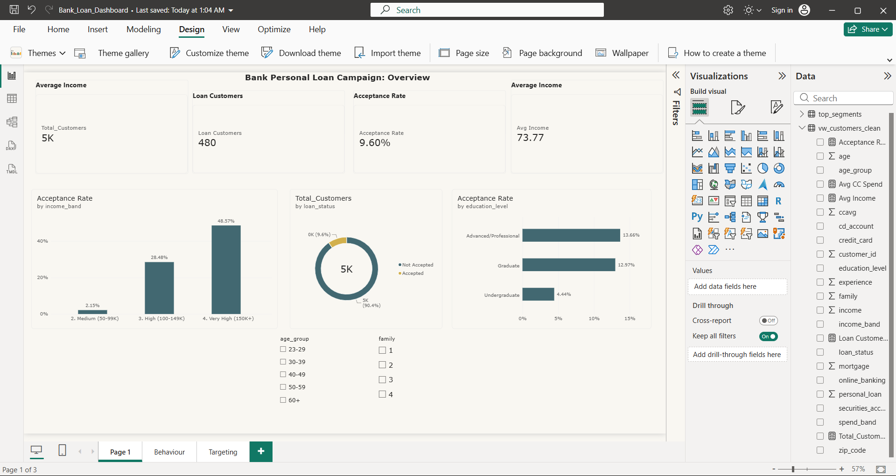
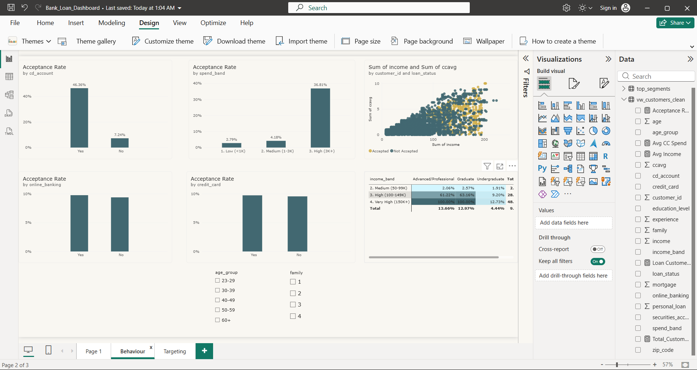
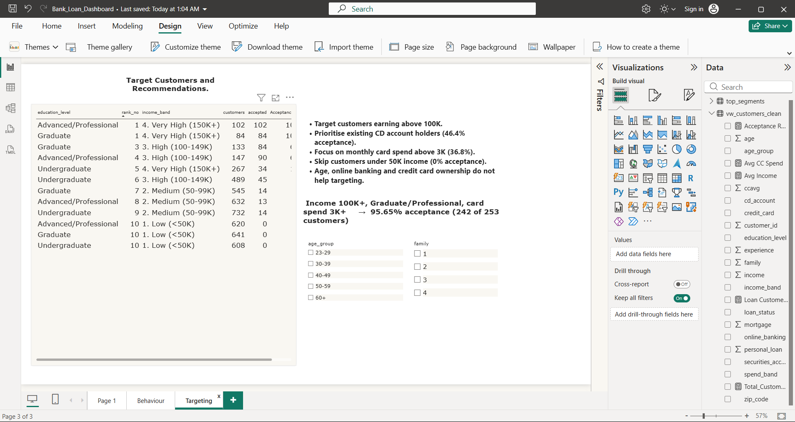

# Bank Personal Loan Analysis using SQL and Power BI

## Project Overview
A bank ran a personal loan campaign on 5,000 customers, and only about 1 in 10 accepted. This project uses SQL and Power BI to find out which customers are most likely to accept, so the next campaign can target them better.

## Tools Used
- **MySQL / DBeaver**: data cleaning and analysis queries
- **Power BI Desktop**: interactive dashboard (3 pages)
- **GitHub**: version control and project documentation

## Repository Structure
```
├── data/                  # dataset files
├── sql/                   # table creation, cleaning view and analysis queries
├── powerbi/
│   ├── Bank_Loan_Dashboard.pbix
│   └── screenshots/       # dashboard page screenshots
├── report/                # project report
└── README.md
```

Workflow
1. Load the raw data into MySQL
2. Clean the data in a SQL view (`vw_customers_clean`)
3. Run the analysis queries
4. Export the clean data to CSV
5. Build the Power BI dashboard

Data Cleaning
- Ignored empty columns
- Fixed negative Experience values using `ABS`
- Padded short ZIP codes with a leading zero
- Converted coded values (education, loan status and so on) into readable labels

 Dashboard
Page 1: Overview.** KPI cards, loan status donut, acceptance rate by income band and education level, with age group and family size slicers.


Page 2: Behaviour.** Acceptance rate by CD account, card spend, online banking and credit card; income vs card spend scatter plot; income × education matrix.


Page 3: Targeting.** Top customer segments, key insight and recommendations.


DAX Measures
- Total Customers
- Loan Customers
- Acceptance Rate
- Avg Income
- Avg CC Spend

Key Findings
| Factor | Result |
|---|---|
| Overall acceptance | 9.6% (480 of 5,000) |
| Income under 50K | 0% acceptance |
| Income 150K+ | 48.57% acceptance |
| Education | Undergraduate 4.44%, Graduate 12.97%, Advanced/Professional 13.66% |
| CD account holders | 46.36% (others 7.24%) |
| Card spend 3K+ per month | 36.81% |
| Online banking, credit card | No meaningful difference (about 9 to 11%) |
| Best segment | Income 100K+, Graduate/Professional, spend 3K+: **95.65%** (242 of 253 customers) |

Recommendations
- Target customers earning above 100K, especially Graduate/Professional.
- Prioritise existing CD account holders.
- Focus on customers spending above 3K a month on cards.
- Skip customers earning under 50K.
- Do not target by age, online banking or credit card ownership.

Limitations and Future Work
This is descriptive analysis of a single campaign. A next step would be a prediction model such as logistic regression or a decision tree.

Team
- Mohd Asim siddiqui
- Arisha Fatima
- Prerna Singh
- Mohd Zaidan Siddiqui
